<div align="center">

<a href="#витрина-экспонатов">
  <picture>
    <source media="(prefers-color-scheme: dark)" srcset="assets/hero-dark.svg">
    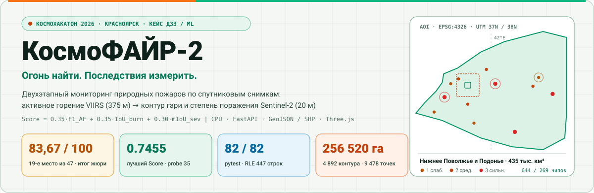
  </picture>
</a>

<br><br>

[](#результаты-и-эксперименты)
[-059669?style=for-the-badge)](submissions/submission_probe_35.csv)
[-0284C7?style=for-the-badge)](docs/presentation.pdf)
[](docs/report.md)

[](https://github.com/overbaffe1/OMLP/actions/workflows/ci.yml)


<br>


</div>

---

## О проекте

**КосмоФАЙР-2** — решение кейса **«Двухэтапный мониторинг природных пожаров по данным ДЗЗ»** окружного этапа **КосмоХакатона 2026** (Красноярск, 18–20 сентября 2026, команда **«Ленивые в орбите»**).

* **Итоговая оценка жюри:** **83,67 балла из 100** · **рейтинг — 19-е место из 47 команд**.
* **Лучший автоматический результат на конкурсной платформе:** **`0.7455`** ([`submissions/submission_probe_35.csv`](submissions/submission_probe_35.csv), конфигурация [`weights/weights_probe_35.json`](weights/weights_probe_35.json)).
* **Презентация защиты:** [`docs/presentation.pdf`](docs/presentation.pdf) (12 слайдов) + расширенная техническая версия ([PDF](docs/presentation-technical.pdf) · [HTML](docs/presentation-technical.html)).

Система решает задачу наблюдения за пожаром **на двух пространственных масштабах** без закрытых моделей, без внешних API во время инференса и без обязательного GPU, а поверх расчётного ядра поднимает аналитический геосервис и 3D-просмотрщик сцен:

| Контур | Сенсор и масштаб | Входные каналы | Выход и модуль |
|---|---|---|---|
| **AF · Активное горение** | VIIRS **375 м** · `256 × 256 px` (≈ 96 × 96 км) | `I1–I5` (в т. ч. яркостные `I4` 3,74 мкм и `I5` 11,45 мкм), углы Солнца/сенсора, WorldCover, DEM, ERA5 | Бинарная маска природного огня `0/1` с отсевом бликов и промфакелов — [`fires/af.py`](fires/af.py), [`fires/blobfilter.py`](fires/blobfilter.py) |
| **BS · Гарь и степень поражения** | Sentinel-2 L2A **20 м** + Sentinel-1 · `512 × 512 px` (≈ 10,2 × 10,2 км) | `B2–B12` и `SCL` до/после пожара, радар `VV/VH` до/после, DEM, тип покрова | Карта степени повреждения растительности `0–3` (нет / слабая / средняя / сильная) — [`fires/bs.py`](fires/bs.py), [`fires/severity.py`](fires/severity.py) |
| **Конкурсный CLI** | `420 AF + 224 BS` train · `180 AF + 89 BS` test | Автоопределение раскладки TIFF и `meta.csv` ([`fires/chips.py`](fires/chips.py)) | Детерминированный `submission.csv` (**447 строк RLE**) с самопроверкой `--validate` — [`inference.py`](inference.py) |
| **Геосервис и 3D** | Полигон **435 тыс. км²** (Нижнее Поволжье и Подонье) | Каталог в WGS84: **9 478** термоточек и **4 892** контура на **256 520 га** | REST API, выгрузка **GeoJSON / Shapefile / CSV**, офлайн веб-карта и Three.js 3D — [`service/`](service/), [`viewer/map.html`](viewer/map.html) |

Целевая метрика соревнования агрегируется **микро-способом** (сначала `TP / FP / FN` суммируются по всему пулу пикселей всех чипов, затем вычисляются компоненты):

```math
\mathrm{Score} = 0.35 \cdot F1_{\mathrm{AF}} + 0.35 \cdot \mathrm{IoU}_{\mathrm{burn}} + 0.30 \cdot \mathrm{mIoU}_{\mathrm{sev}}
```

---

## Витрина экспонатов

Три способа рассмотреть данные и работу алгоритма **прямо в интерфейсе GitHub** — без клонирования и запуска сервера:

<p align="center"><a href="assets/burnscar-wipe.gif">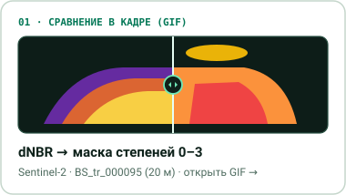</a> <a href="assets/dnbr-relief.stl">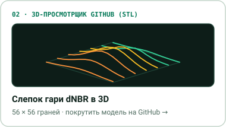</a> <a href="assets/burn-contours-top50.geojson">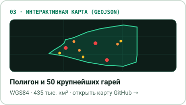</a></p>

### Снимок до/после → карта степеней поражения

Один и тот же обучающий чип **`BS_tr_000095`** (`512 × 512 px`, `10,2 × 10,2 км`, шаг 20 м). Слева от движущейся границы — разностный спектральный индекс гари $\mathrm{dNBR} = \mathrm{NBR}_{\mathrm{pre}} - \mathrm{NBR}_{\mathrm{post}}$, справа — предсказанная моделью карта классов `0–3`:

<p align="center">
  <a href="docs/figures/severity.png">
    <picture>
      <source media="(prefers-reduced-motion: reduce)" srcset="assets/burnscar-wipe.png">
      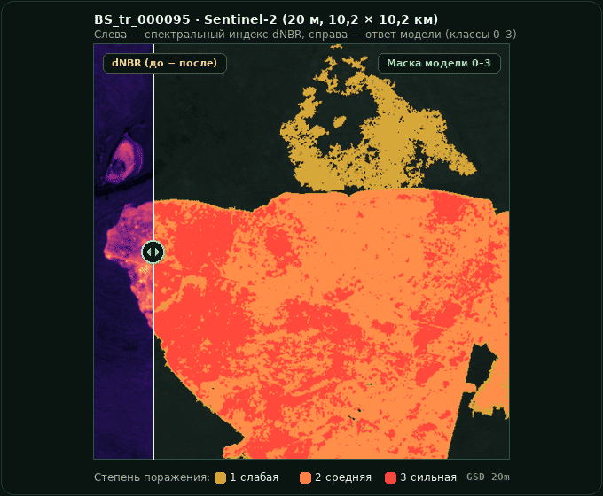
    </picture>
  </a>
</p>

<p align="center">
  <a href="assets/dnbr-relief.stl"><b>Покрутить этот же чип как 3D-рельеф (STL) →</b></a> ·
  <a href="assets/burn-contours-top50.geojson"><b>Открыть 50 крупнейших гарей на карте (GeoJSON) →</b></a> ·
  <a href="assets/burnscar-wipe.png">Стоп-кадр без движения (PNG)</a>
</p>

<details>
<summary><b>Сверить ответ с эталоном организаторов, слоями SWIR и тепловым каналом VIIRS I4</b></summary>
<br>

**1. BS — dNBR, эталон и ответ модели рядом (`BS_tr_000095`, Sentinel-2, 20 м):**

<a href="docs/figures/severity.png">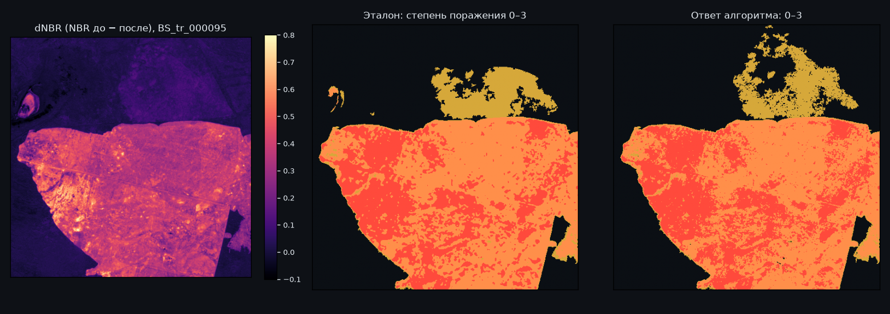</a>

**2. Четыре представления одной сцены (`BS_tr_000117`: RGB, SWIR, dNBR и эталон 1–3):**

<a href="assets/chip-000117-layers.png">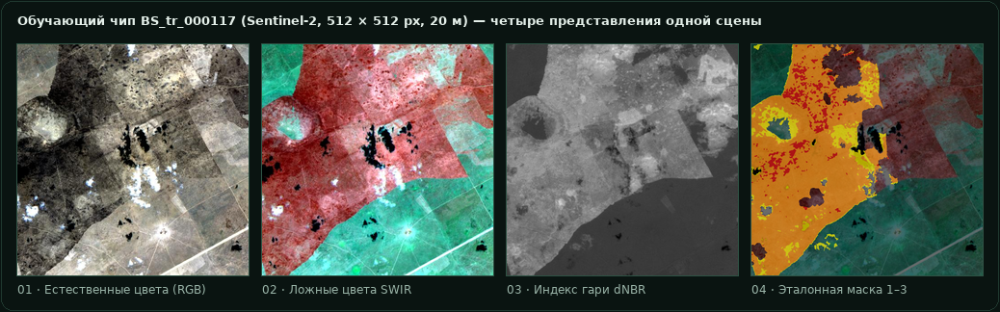</a>

**3. AF — яркостная температура VIIRS `I4` (3,74 мкм) и выделенные очаги (`AF_tr_000001`, 375 м):**

<a href="docs/figures/detection.png">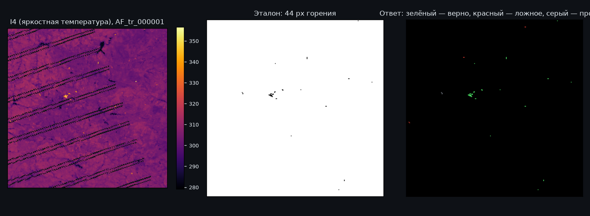</a>

</details>

---

## Результаты и эксперименты

Полная хронология гипотез, замеров и откатов задокументирована в [`docs/experiments.md`](docs/experiments.md), базовые замеры и абляции — в [`docs/report.md`](docs/report.md).

<p align="center">
  <a href="docs/experiments.md">
    <picture>
      <source media="(prefers-color-scheme: dark)" srcset="assets/experiments-dark.svg">
      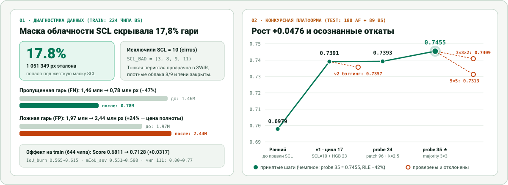
    </picture>
  </a>
</p>

### Три решения, определившие итоговый результат

1. **Диагностика маски облачности `SCL = 10` (`+0.0317` на train, скачок `0.6979 → 0.7391` на платформе).**
   Вскрытие худших сцен ([`tools/diag_chip.py`](tools/diag_chip.py), [`tools/diag_scl.py`](tools/diag_scl.py)) показало, что **17,8%** всей эталонной гари в `train` (**1 051 349 px**) отсекалось маской `SCL`: на сухой почве класс `10` (тонкая перистая облачность) накрывал до 100% кадра при `cloud_frac ≈ 0`, хотя в SWIR сигнал гари оставался контрастным (медианный `dNBR` **0.218** против **−0.028** у фона). Исключение `10` из `SCL_BAD = (3, 8, 9, 11)` снизило пропуски `FN` на **47%** (`1,46 → 0,78 млн px`) при контролируемом росте `FP` (`1,97 → 2,44 млн px`); на чипе `BS_tr_000111` `IoU_burn` вырос с `0.000` до **`0.773`**.
2. **Градиентный бустинг на 23 признаках пикселя и окружения (`+0.029` Score на честном hold-out `fire_event_id`).**
   Одного индекса `dNBR` недостаточно на пашне и в степи (66% и 32% ложных срабатываний порогового бейзлайна из-за фенологической уборки урожая). Модель `HistGradientBoostingClassifier` ([`fires/severity.py`](fires/severity.py)) объединяет `NBR/dNBR/rdNBR`, `NDVI`, `NDMI`, спектральные разности, локальный контекст окна, радар `Sentinel-1 VV/VH` и тип покрова `WorldCover`, поднимая `IoU_burn / mIoU_sev` на 56 отложенных чипах с `0.4871 / 0.4793` до **`0.5391 / 0.5146`** без нейросетей и без GPU.
3. **Пространственное голосование `majority 3 × 3` + чистка мелких пятен `96 px` (`0.7393 → 0.7455`, чемпион `probe 35`).**
   Попиксельный классификатор оставляет «соль и перец» на стыке степеней `1 ↔ 2 ↔ 3`. Один проход фильтра большинства `3 × 3` вместе с `min_patch_px = 96` и `af.k_sigma = 2.5` принёс **`+0.0062`** на платформе и одновременно сжал `submission_probe_35.csv` на **42%** (`5,32 → 3,07 МБ`) за счёт слияния разрозненных серий RLE.

### Честные инженерные компромиссы и откаты

> [!NOTE]
> Улучшение в соревновательном ML — это ещё и умение вовремя откатиться. Все проверенные отрицательные гипотезы сохранены в коде и документации.

| Проверенная гипотеза | Замер | Почему отклонили |
|---|---|---|
| **v2:** 40 признаков + бэггинг на 3 сидах + бинарная голова «гарь/фон» | `+0.025` на локальном `val`, но **`0.7357`** против `0.7391` на платформе | Отложенные 56 чипов делили с `train` артефактную структуру `SCL`; бинарная голова пережала площадь гари (`14,99%` вместо `16,83%`) — откатились на `v1` |
| Усиленное сглаживание: `majority 5 × 5` (`p36`) и двойной `3 × 3` (`p41`) | **`0.7313`** и **`0.7409`** против **`0.7455`** у одиночного `3 × 3` | Крупное окно и повторный проход съедают узкие кромки и мелкие пятна степени 3 |
| ML-классификатор очагов AF ([`fires/blobfilter.py`](fires/blobfilter.py), 23 признака блоба) | `F1 = 0.8980` против **`0.9225`** у контекстных правил | На данных кейса кандидатные блобы почти всегда являются пожарами; оставлен авто-выбором в `train.py` |
| Восстановление гари под облаками по радару Sentinel-1 (`sar_recovery`) | `−0.096` Score на валидации | Отклик `ΔVH` грубее оптического `dNBR` и плодит ложные контуры на сельхозполях |
| Заливка внутренних дыр (`fill_holes_mask`) поверх бустинга | `−0.0078` Score на абляции | Модель различает реальные несгоревшие острова внутри пожарища — заливать их нельзя |

<details>
<summary><b>Таблица ключевых абляций на обучающем наборе (644 чипа: 420 AF + 224 BS)</b></summary>
<br>

Базовый срез `python evaluate.py --data-dir <train> --ablation` (до размаскировки `SCL = 10`, [`docs/numbers.json`](docs/numbers.json)):

| Конфигурация | Score | Δ Score | `F1_AF` | `IoU_burn` | `mIoU_sev` |
|---|---:|---:|---:|---:|---:|
| Базовая модельная конфигурация (`train`) | **0.6811** | — | **0.9093** | **0.5647** | **0.5506** |
| + исключение `SCL = 10` из жёсткой маски (контроль `train`) | **0.7128** | **+0.0317** | **0.9093** | **0.6150** | **0.5977** |
| AF: только абсолютные пороги (без контекстного окна `71 × 71`) | 0.3962 | −0.2849 | 0.0953 | 0.5647 | 0.5506 |
| BS: пороги `dNBR` по покровам вместо обученного бустинга | 0.6037 | −0.0774 | 0.9093 | 0.4371 | 0.4415 |
| AF: единая дневная шкала (без ночных порогов на 127 чипах, SZA > 95°) | 0.6682 | −0.0129 | 0.8725 | 0.5647 | 0.5506 |
| BS: без фильтрации мелких контуров (`min_patch_px`) | 0.6720 | −0.0092 | 0.9093 | 0.5469 | 0.5409 |
| BS: с принудительным заполнением дыр (`fill_holes_mask = true`) | 0.6733 | −0.0078 | 0.9093 | 0.5508 | 0.5410 |

</details>

---

## Архитектура

<p align="center">
  <a href="assets/architecture.mmd">
    <picture>
      <source media="(prefers-color-scheme: dark)" srcset="assets/architecture-dark.svg">
      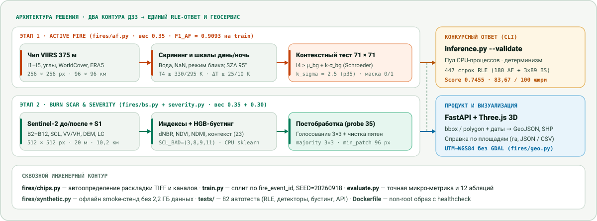
    </picture>
  </a>
</p>

[Редактируемый исходник схемы (`assets/architecture.mmd`)](assets/architecture.mmd)

<details>
<summary><b>Структура репозитория</b></summary>
<br>

```text
OMLP/
├── inference.py                 # Обязательный CLI кейса: --data-dir → submission.csv (--validate)
├── train.py                     # Обучение и подбор порогов со сплитом по fire_event_id (CPU / CUDA)
├── evaluate.py                  # Точная микро-метрика соревнования, --strict и 12 абляций
├── fires/                       # Вычислительное ядро ДЗЗ
│   ├── chips.py                 # Автоопределение раскладки TIFF, стеков каналов и meta.csv
│   ├── af.py                    # AF: скрининг воды/блика, шкалы день/ночь (95°), контекст 71×71
│   ├── blobfilter.py            # Альтернативный ML-фильтр очагов AF (23 признака блоба)
│   ├── bs.py                    # BS: NBR/dNBR/rdNBR, SCL_BAD=(3,8,9,11), S1 VV/VH, морфология
│   ├── severity.py              # HistGradientBoosting / XGBoost (23/40 признаков) + majority 3×3
│   ├── morphology.py            # Морфология, связные компоненты и фильтр большинства
│   ├── submission.py            # RLE-кодек (1-индексация, склейка серий) и валидатор шаблона
│   ├── vectorize.py             # Трассировка контуров + упрощение Дугласа — Пекера + гектары
│   ├── geo.py                   # Пересчёт UTM 37N/38N → WGS84 на чистом NumPy (без GDAL/pyproj)
│   ├── metrics.py               # Микро-метрики F1_AF, IoU_burn, mIoU_sev и итоговый Score
│   ├── weights.py               # Загрузка и сериализация JSON-конфигураций
│   └── synthetic.py             # Генератор синтетических чипов для быстрых офлайн-проверок
├── service/                     # Информационно-аналитический геосервис (FastAPI)
│   ├── app.py                   # REST API, выгрузка GeoJSON / Shapefile / CSV и офлайн веб-карта
│   ├── catalog.py               # Сборщик геокаталога из чипов и предсказаний
│   └── catalog.json             # Готовый каталог train в WGS84 (9 478 точек, 4 892 контура, 256 520 га)
├── viewer/
│   └── map.html                 # Автономный 3D-просмотрщик чипов (Three.js, высота = dNBR)
├── weights/                     # weights_probe_35.json + severity_model_p35.pkl (0.7455) и v1 (0.7391)
├── submissions/                 # Валидированный чемпионский ответ submission_probe_35.csv (447 строк)
├── data/aoi/                    # Официальный полигон мониторинга (GeoJSON, GeoPackage, Shapefile)
├── tools/                       # Диагностика SCL/ошибок, цикл обучения, сборка слайдов и витрины
├── tests/                       # 82 автотеста (детекторы, бустинг, RLE, раскладка, метрика, REST API)
├── docs/                        # presentation.pdf (защита), report.md, experiments.md, материалы кейса
├── assets/                      # Иллюстрации README, шторка GIF, 3D STL и карта GeoJSON
└── Dockerfile                   # Non-root контейнер для сервиса и пакетного инференса
```

</details>

---

## Продукт: геосервис REST API и 3D-интерфейс dNBR

Помимо пакетного `inference.py`, проект включает готовый информационно-аналитический сервис ([`service/app.py`](service/app.py)) на реальном каталоге WGS84 (**256 520 га** гари: `92 675 / 107 248 / 56 597 га` по степеням `1 / 2 / 3`) и интерактивный 3D-просмотрщик чипов на **Three.js** ([`viewer/map.html`](viewer/map.html)), где интенсивность `dNBR` поднимается рельефом над спутниковым снимком:

<p align="center">
  <a href="docs/presentation.pdf">
    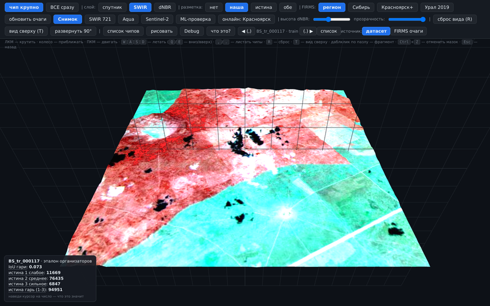
  </a>
</p>

| Метод и путь | Назначение |
|---|---|
| `GET /` · `GET /docs` | Автономная веб-карта (контуры по степеням + термоточки + сводка, без внешних тайлов) и Swagger UI |
| `POST /api/query` | Единый запрос по `bbox` или `polygon` + интервалу дат → термоточки, контуры и аналитическая справка |
| `GET /api/thermopoints` | Термоточки активного горения за период в формате **GeoJSON** (`bbox`, `date_from`, `date_to`) |
| `GET /api/burn-contours` | Векторные контуры гари с атрибутами `id`, `severity`, `area_ha`, `chip_id`, `date` |
| `GET /api/report?format=json\|csv` | Справка: суммарная площадь гари в гектарах, разбивка по степеням `1 / 2 / 3`, число контуров |
| `GET /api/export/contours.geojson` · `.shp` | Выгрузка контуров в **GeoJSON** или ZIP-архив **Shapefile** (`.shp/.shx/.dbf/.prj`) для QGIS / ArcGIS |
| `GET /api/health` · `GET /api/catalog/reload` | Проверка состояния и горячая перезагрузка каталога без остановки сервиса |

---

## Презентация защиты

Лаконичная презентация защиты (**12 слайдов**) лежит в репозитории: **[`docs/presentation.pdf`](docs/presentation.pdf)**.

<p align="center">
  <a href="docs/presentation.pdf">
    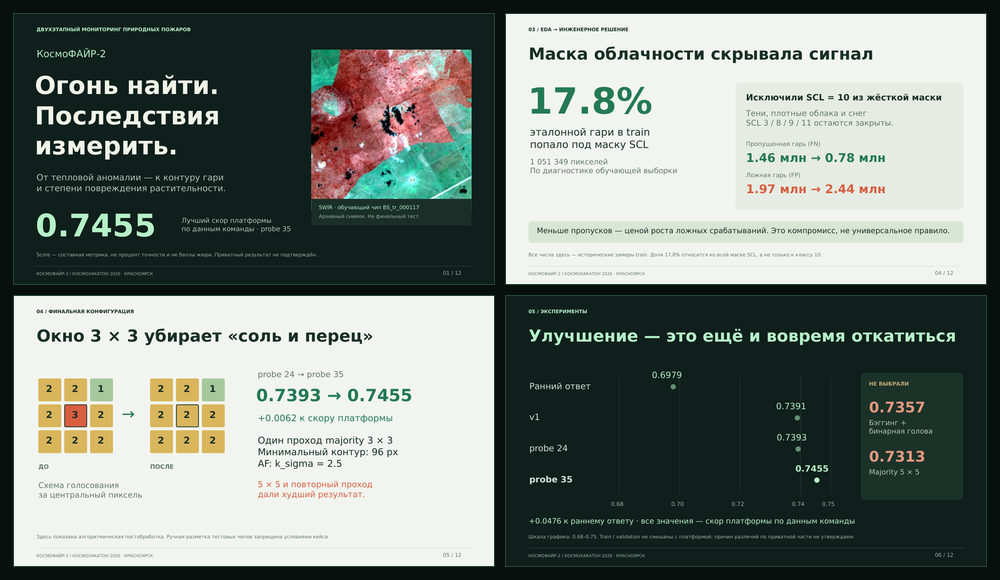
  </a>
</p>

* **[Открыть презентацию защиты (`docs/presentation.pdf`, 12 слайдов) →](docs/presentation.pdf)**
* Расширенная техническая презентация к отчёту (17 слайдов): [`docs/presentation-technical.pdf`](docs/presentation-technical.pdf) · [`docs/presentation-technical.html`](docs/presentation-technical.html)

---

## Быстрый старт и проверка

Требования: **Python 3.11+** (без GPU, без GDAL) либо **Docker**.

### 1. Проверить весь конвейер за 30 секунд (без скачивания 2,2 ГБ снимков)

```bash
git clone https://github.com/overbaffe1/OMLP.git
cd OMLP

python -m venv .venv && source .venv/bin/activate
pip install -r requirements.txt

# 1) Все 82 модульных и интеграционных теста
pytest tests -q

# 2) Синтетический smoke-стенд + инференс с чемпионскими весами probe 35 + валидация RLE
python -m fires.synthetic /tmp/fires-demo --n-af 20 --n-bs 10 --seed 11 --clean
python inference.py \
  --data-dir /tmp/fires-demo \
  --weights weights/weights_probe_35.json \
  --output /tmp/submission.csv \
  --validate

# 3) Геосервис с реальным каталогом WGS84 (9 478 термоточек, 4 892 контура)
uvicorn service.app:app --host 0.0.0.0 --port 8000
# Веб-карта: http://localhost:8000  |  Swagger API: http://localhost:8000/docs
```

### 2. Инференс и обучение на реальных данных кейса

```bash
# Диагностика раскладки каналов TIFF
python -m fires.chips --data-dir /path/to/test

# Конкурсный ответ (конфигурация-чемпион probe 35 → 0.7455)
python inference.py \
  --data-dir /path/to/test \
  --weights weights/weights_probe_35.json \
  --output submission.csv \
  --validate

# Оценка метрики с абляциями и переобучение с нуля (SEED = 20260918)
python evaluate.py --data-dir /path/to/train --weights weights/weights_probe_35.json --ablation
python train.py --data-dir /path/to/train --device auto --out weights/weights_retrained.json
```

### 3. Запуск в Docker

```bash
docker build -t cosmofire2 .

# Поднять REST API и веб-карту на :8000
docker run --rm -p 8000:8000 cosmofire2

# Или прогнать пакетный инференс на примонтированном каталоге данных
docker run --rm -v "$PWD/data:/data" cosmofire2 \
  python inference.py --data-dir /data/test --weights weights/weights_probe_35.json \
  --output /data/submission.csv --validate
```

<details>
<summary><b>Пересобрать визуальные экспонаты README (GIF, STL, GeoJSON, SVG)</b></summary>
<br>

Векторные иллюстрации собираются одной стандартной библиотекой Python 3; для растровой шторки, STL и превью слайдов нужны `Pillow`, `numpy` и `pymupdf`:

```bash
python3 tools/build_portfolio_svg.py
python3 tools/build_portfolio_assets.py
```

Чтобы открыть интерактивный 3D-просмотрщик чипов, скачайте [`viewer/map.html`](viewer/map.html) и откройте его в браузере (для онлайн-слоя NASA FIRMS в панели `Debug` при желании указывается собственный бесплатный `MAP_KEY`; ключи в репозитории не хранятся).

</details>

---

## Материалы хакатона и источники

| Материал | Описание |
|---|---|
| [`docs/presentation.pdf`](docs/presentation.pdf) | Финальная презентация защиты проекта (12 слайдов) |
| [`docs/experiments.md`](docs/experiments.md) | Хронология экспериментов: находка `SCL = 10`, пробы платформы до `0.7455` и откаты |
| [`docs/report.md`](docs/report.md) · [`RUNBOOK.md`](RUNBOOK.md) | Полный инженерный отчёт (EDA, физика каналов, абляции, скорость) и эксплуатационный runbook |
| [`weights/`](weights/README.md) · [`submissions/`](submissions/README.md) | Веса чемпиона `probe 35` (`0.7455`), базовые веса `v1` (`0.7391`) и валидированный RLE-ответ |
| [`data/aoi/`](data/aoi/README.md) | Граница территории мониторинга (435 тыс. км², EPSG:4326) в GeoJSON, GeoPackage и Shapefile |
| [`docs/hackathon/`](docs/hackathon/) | Постановка кейса, официальные критерии оценки (100 баллов) и положение КосмоХакатона 2026 |

**Научная основа и открытые данные:** контекстный алгоритм активного горения адаптирован по публикации *Schroeder et al. (2014), «The New VIIRS 375 m active fire detection data product»*; спектральная шкала гари `dNBR` — по методике *Key & Benson (2006), USGS FIREMON*. Используются открытые спутниковые данные NASA VIIRS, ESA Copernicus Sentinel-1/2, ESA WorldCover v200 (CC BY 4.0) и ECMWF ERA5. Код распространяется под лицензией [MIT](LICENSE).

> [!TIP]
> Готовая карточка предпросмотра ссылки репозитория (`1280 × 640`) лежит в [`assets/social-preview.png`](assets/social-preview.png) — подключается в **Settings → Social preview**.

<div align="center">
  <picture>
    <source media="(prefers-color-scheme: dark)" srcset="assets/footer-dark.svg">
    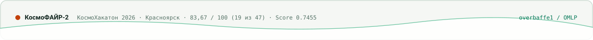
  </picture>
</div>
